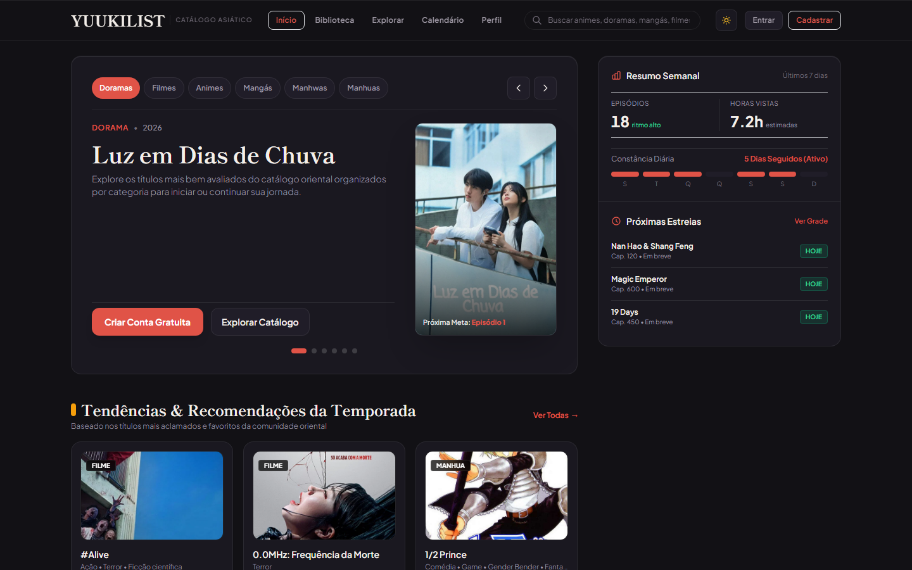

# YuukiList - Catálogo e Rastreador de Entretenimento Asiático

Em produção — acesse em **[https://yuuki-list-two.vercel.app/](https://yuuki-list-two.vercel.app/)**.

> Plataforma unificada, minimalista e de alta fidelidade para catalogar, acompanhar e registrar o consumo de doramas, filmes, animes, mangás, manhwas e manhuas em um único lugar — sem anúncios e com estética editorial asiática.

[](https://yuuki-list-two.vercel.app/)
[](xspec/constitution.md)

[](https://yuuki-list-two.vercel.app/)

---

## Visão Geral

O **YuukiList** resolve a fragmentação do consumo de mídia oriental, reunindo em uma experiência única e coesa o catálogo canônico, o rastreamento tátil de progresso, diário de impressões, calendário de lançamentos, compartilhamento público e perfil editorial.

O projeto é construído sob governança determinística **X-Spec v2.0.1**, com **38 mudanças concluídas**, **25 Living Specs** e **365 testes automatizados**.

---

## Funcionalidades Principais

- **Exploração e Catálogo Unificado**:
  - Filtros por categoria (Dorama, Filme, Anime, Mangá, Manhwa, Manhua), status de publicação, país de origem (JP, KR, CN, TW, TH), gênero e busca aproximada.
  - Rolagem infinita com preservação de estado na URL e debounce de busca.
  - Detalhes canônicos de obras com sinopse, títulos originais, árvore de relacionamentos/franquias e capas com fallback vetorial resiliente.

- **Biblioteca Pessoal Tátil**:
  - Alternância imediata entre visualização em Grade (*Grid*) e Lista (*Row*).
  - Barra de progresso visual proporcional e botão de incremento rápido (*+1*) com alvo tátil de 44x44px (WCAG 2.2 AA).
  - Filtros por estado pessoal (*Assistindo/Lendo*, *Quero Assistir/Ler*, *Concluídos*, *Pausados*, *Dropados*).

- **Diário de Consumo & Notas**:
  - Registro persistente no PostgreSQL (`history_events`) de episódios e capítulos com data, nota, impressões textuais e proteção contra spoilers.
  - Linha do tempo cronológica desacoplada do estado atual da biblioteca.

- **Calendário Semanal (*Weekly Strip*)**:
  - Barra horizontal de 7 dias com contadores dinâmicos de lançamentos.
  - Agrupamento temporal por turnos (*Manhã*, *Tarde*, *Noite*).
  - Ação rápida de *"Lembrar / Seguir"* e badges de confiabilidade de fontes.

- **Perfil Editorial Showcase, Compartilhamento & LGPD**:
  - Vitrine de favoritos em destaque com proporção editorial 2:3 e analítica de consumo.
  - Links públicos somente leitura (`/share/:token`) persistidos no PostgreSQL (`share_links`) com expiração configurável (7, 30 ou 90 dias) e revogação imediata.
  - Conformidade LGPD com exportação de dados em CSV e JSON, além de exclusão definitiva de conta.

- **Experiência PWA & Modo Offline**:
  - Manifesto instalável W3C em conformidade com dispositivos móveis e desktop.
  - Service Worker resiliente com estratégia *Network-First* e cache seguro offline.

---

## Design System: Asian Editorial Foundation

A identidade visual do YuukiList adota estética minimalista e mineral inspirada em publicações editoriais orientais:

- **Paleta Mineral**:
  - Fundo base: Nanquim escuro profundo (`#0B0A0F` / `var(--color-bg-base)`)
  - Superfícies elevadas: Nanquim suave (`#14131A` e `#1A1820`)
  - Bordas e divisores: Traço sutil grafite (`#2B2735`)
  - Acento e destaque: Carmim mineral (`#E05347` / `var(--color-accent)`)
  - Texto e contraste: Papel cru (`#EDEDED`) e cinza mineral (`#9C96A2`)
- **Tipografia**: Escala balanceada em 3 níveis de legibilidade editorial, alternância Dark/Light Editorial, links de salto acessíveis e anel de foco visível.

---

## Arquitetura e Deploy em Produção

O projeto opera em **deploy monolítico unificado de custo zero** (Vercel Hobby + Supabase Free) e é estruturado como monorepo:

```text
YuukiList/
├── apps/
│   ├── api/          # Domínio modular, Prisma ORM (PostgreSQL/Supabase), auth JWT e clientes externos
│   └── web/          # Frontend Next.js 15 (App Router, React 19, Tailwind) + Route Handlers (/api/v1/*)
├── docs/
│   └── screenshots/  # Capturas da interface em produção
├── packages/
│   └── shared/       # DTOs compartilhados, tipos, schemas e constantes de domínio
├── tests/            # Suíte determinística com 365 testes automatizados
└── xspec/            # Especificações vivas, constituição e motor X-Spec v2.0.1
```

- **Aplicação Web & API:** [https://yuuki-list-two.vercel.app/](https://yuuki-list-two.vercel.app/) (Next.js 15 na Vercel via [vercel.json](vercel.json))
- **Banco de Dados:** PostgreSQL gerenciado no Supabase (`DATABASE_URL` com PgBouncer na porta `6543` e `DIRECT_URL` na porta `5432`)
- **Monitoramento & Keep-Alive:** Endpoint [GET /api/v1/health](https://yuuki-list-two.vercel.app/api/v1/health) (`SELECT 1` + payload sanitizado) consultado periodicamente por [.github/workflows/supabase-keepalive.yml](.github/workflows/supabase-keepalive.yml)

---

## Como Executar Localmente

### Pré-requisitos

- **Node.js**: v22.x ou superior
- **npm**: v10.x ou superior

### Instalação e Variáveis de Ambiente

```bash
# Clone o repositório
git clone https://github.com/xouel/YuukiList.git
cd YuukiList

# Instale as dependências de todos os workspaces (executa prisma generate via postinstall)
npm install

# Copie o exemplo de variáveis de ambiente e preencha suas chaves
cp .env.example .env
```

Consulte [.env.example](.env.example) para os detalhes das strings `DATABASE_URL`, `DIRECT_URL`, `JWT_SECRET` (obrigatório em produção) e chaves do Supabase/TMDB.

### Executar os Testes

```bash
npm test
```

### Compilar a Aplicação

```bash
npm --workspace=@yuukilist/web run build
```

### Iniciar em Desenvolvimento

```bash
# Iniciar o servidor web + rotas /api/v1/*
npm --prefix apps/web run dev

# Ou iniciar o build de produção
npm --prefix apps/web run start
```

Acesse a aplicação em [http://localhost:3000](http://localhost:3000).

---

## Governança e Especificação

Este repositório é governado pelo framework **X-Spec**:

- `xspec/constitution.md`: Princípios arquiteturais inegociáveis.
- `xspec/specs/`: 25 Living Specs refletindo as capacidades em produção.
- `xspec/bin/xspec.mjs doctor`: Verificação determinística de saúde do repositório.

---

## Licença

Distribuído sob a licença MIT. Consulte `LICENSE` para mais detalhes.
